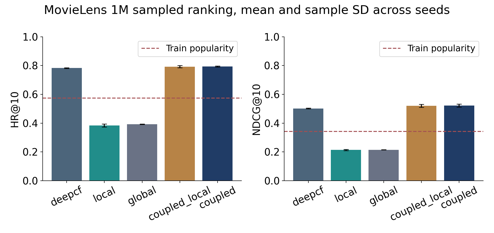
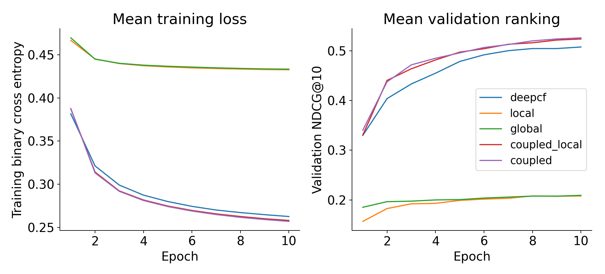

# CoupledCF on MovieLens 1M

Research Paper Study and Partial Reproduction

Recommendation Systems. [Institution]. [Group number].

| Student | Roll number | Actual contribution |
| --- | --- | --- |
| [Student name] | [Roll number] | [Describe actual individual contribution] |
| [Student name] | [Roll number] | [Describe actual individual contribution] |

### Abstract

This project studies the attribute-based Top-N recommendation mechanism of Zhang et al. [1]. It implements a convolution over explicit user-item feature interactions, an implicit DeepCF baseline, and their combination in PyTorch. The study uses the complete official MovieLens 1M interaction set, one fixed random split, 99 unobserved evaluation candidates per target and matched training procedures. Five variants are evaluated across three model seeds, with validation-only checkpoint selection.

The complete model achieves mean HR@10 0.7937 and NDCG@10 0.5224. Its NDCG@10 is 0.0202 higher than DeepCF. The combined model improves the measured mean ranking score under this budget. The experiment supports a benefit for this implemented fusion on this split, but does not isolate all architectural and parameter-count effects.

This is a partial reproduction of the mathematical mechanism, not a claim of exact numerical replication. The feature projection, catalogue convention, validation holdout and CPU training budget are explicit adaptations. Human student identities and individual contributions remain editable placeholders.

### Scope and evidence

Parts A and B analyze the complete paper. Part C reproduces the attribute-based Top-N component on MovieLens 1M. All results below come from completed run records, selected checkpoints and per-user ranks. Rating prediction, review-based embeddings and the other datasets are discussed rather than experimentally reproduced.

## Part A Research paper understanding

### Problem and motivation

The main implemented problem is personalized Top-N recommendation from implicit feedback. A model scores an unobserved user-item pair and ranks candidate items. The original paper also considers explicit rating regression. It is not a sequential recommender, an image-based multimodal model, or a dedicated explainability method. The authors discuss sparsity and cold start as motivations, but our warm-user holdout does not test true new-user or new-item generalization.

User histories are sparse relative to the catalogue. A pure collaborative model learns ID factors from observed behavior and can miss relationships exposed by demographics or item attributes. The paper argues that recommendation data are non-independent and heterogeneous. Gender, occupation, genre and latent preferences can interact across users and items. The practical motivation is to use these relationships to improve ranked recommendations when behavioral evidence alone is limited.

### Research gap and claimed contributions

The authors argue that existing methods do not jointly represent explicit user-item attribute couplings and implicit latent interactions. Their contribution is a generic neural framework that combines a CNN-based explicit coupling learner with DeepCF, and separates local CNN patterns from a global flattened cross-product representation. The framework can receive categorical/numeric side attributes or review-derived features. These are the authors' claims, not a proof that all prior recommenders assume independent data or cannot model feature interactions.

Related methods in the paper include matrix factorization, NeuMF, Wide and Deep, DeepFM, ConvMF and A3NCF. NeuMF learns nonlinear collaborative interactions. Wide and Deep combines memorization with dense generalization. DeepFM combines factorization-machine feature interactions with a deep network. ConvMF and A3NCF incorporate review-derived information. DeepCF is a paper-internal ablation and is the appropriate directly implemented baseline here.

### Paper datasets and evaluation settings

The original study uses MovieLens 1M and Tafeng for attribute-based Top-K recommendation, MovieLens 1M and BookCrossing for attribute-based rating prediction, and Amazon Movies and TV and Yelp for review-based recommendation and rating tasks. Its processed dataset sizes differ by task and filtering. For MovieLens, Table 2 reports 6,040 users and 1,000,209 ratings. For Top-K, every observed rating becomes an interaction and four unobserved negatives are sampled per positive. The evaluation uses one randomly selected observed item and 99 unobserved items per user.

The paper has reporting ambiguities beyond missing implementation details. Table 3 lists 509,218 Yelp ratings and 192,056 users, averaging about 2.65 ratings per user, while the text states a minimum of five ratings per user. Those counts and that filter cannot simultaneously describe the same processed set. Some reported percentage gains also use absolute metric differences: the MovieLens HR@10 gap of 0.0942 over NeuMF is 9.42 percentage points, or approximately 12.89 percent relative improvement. This report uses absolute score deltas and verifies its MovieLens counts independently.

The Top-K settings on PDF pages 9-10 include Adam, learning rate 0.001, ID dimension 32, side dimension reported as 8 for MovieLens, 3 by 3 filters with eight channels, a 64-unit final hidden layer, batch size 256 and dropout 0.5. The maximum is 100 epochs, with best performance described around epoch 30. Table 6 on page 11 concerns rating prediction and is not the Top-K configuration.

| Published variant | HR@10 | NDCG@10 |
| --- | --- | --- |
| DeepCF | .7147 | .4312 |
| Local CoupledCF | .8212 | .5408 |
| Global CoupledCF | .7826 | .5252 |
| CoupledCF | .8252 | .5440 |

These values are transcribed from Table 7 on supplied PDF page 11, printed page 123954. They are published references, not measurements produced by this project. The paper reports stronger MovieLens ranking for the combined method than for its internal DeepCF baseline. It does not provide the seed-level uncertainty or every implementation detail required to reproduce those values exactly.

## Part B Methodology and algorithm analysis

The model receives user and item identities, four user demographic fields and the movie genre set. The observable side-information branch and latent ID branch are learned jointly from the binary interaction objective. A high score means a pair is likely to be an observed interaction relative to the sampled negatives. It is not a calibrated probability of a future purchase or a star rating.

| Stage | Implementation and output |
| --- | --- |
| Input | Contiguous user/item IDs; gender, age group, occupation, ZIP; 18 genre flags |
| Feature extraction | Four categorical user embeddings; multi-hot movie genre encoding |
| Representation | Project side information to user/item vectors of width 8; ID vectors of width 32 |
| Explicit interaction | Outer product gives 8 by 8 matrix; CNN and max pool give local 72-vector; flatten gives global 64-vector |
| Implicit interaction | Elementwise ID embedding product; dense network gives 64-vector |
| Fusion and output | Concatenate active branches; dense fusion; one scalar interaction logit; rank items |

### Explicit coupling equations

Let a and b be the learned side vectors. The coupling matrix is X[j,k] = a[j] b[k]. This outer product includes every cross-coordinate interaction. It is different from the elementwise product used by DeepCF. The local branch computes ReLU(Conv2D(X)) followed by max pooling. A 3 by 3 valid filter turns an 8 by 8 matrix into a 6 by 6 map. Eight channels and 2 by 2 max pooling produce eight 3 by 3 maps, hence a local vector with 72 entries. The global branch preserves all 64 original coupling entries by flattening X.

### Implicit coupling and prediction

Let p[u] and q[i] be learned ID embeddings. The implicit interaction is z = p[u] elementwise times q[i]. A dense layer, batch normalization, ReLU and dropout transform z into a 64-dimensional representation. The complete model first joins the 72 local and 64 global values and applies a 64-unit explicit MLP. It concatenates that explicit vector with the implicit 64-vector, giving 128 joint-fusion inputs. A second 64-unit fusion layer and scalar output produce the ranking logit. This follows the explicit-MLP-then-implicit-fusion order described on PDF page 7.

For logit s and binary label y, the objective is binary cross entropy, L = -y log(sigmoid(s)) - (1-y) log(1-sigmoid(s)). The implementation uses BCEWithLogitsLoss to compute the same objective stably. Adam optimizes all active branch weights jointly. Embeddings use a zero-mean normal initialization with standard deviation 0.01. Dense layers use Xavier initialization and zero biases. Batch normalization and dropout are active in training and disabled or fixed to their learned statistics in evaluation.

### The complete paper beyond this implementation

For review-based side information, the paper builds user and item review documents and learns Doc2Vec PV-DM representations before coupling them. It discusses Word2Vec and PV-DBOW as related alternatives. For rating prediction, it changes the output/loss to regression with squared error and evaluates RMSE and MAE. This project does not substitute genre embeddings for a claimed Doc2Vec reproduction and does not report rating-regression results.

## Part C Implementation and experimental protocol

The selected technique is implemented directly in src/coupledcf/models.py. data.py owns source parsing, ID encoding, side features, split construction and negative sampling. metrics.py owns tie-aware single-positive ranking. engine.py owns Adam training, validation selection, resource observation and final evaluation. The scripts expose dataset preparation, training, checkpoint evaluation and result generation. This division keeps split and negative-pair rules in one place and permits every variant to use the same scorer API.

### Dataset provenance and preprocessing

MovieLens 1M was obtained from the official GroupLens archive [2]. Its MD5 is c4d9eecfca2ab87c1945afe126590906, matching the published checksum. The parsed data contain 1,000,209 distinct user-item interactions, 6,040 users, 3,883 movie metadata records and 3,706 rated movies. The maximum original movie ID is 3,952. The paper lists 3,952 items, so this implementation makes its actual catalogue convention explicit.

Sorted original IDs define zero-based mappings. ZIP remains a categorical string so leading zeros are preserved. Gender, age-group, occupation and ZIP vocabularies are recorded in the manifest. Each user field receives an eight-dimensional embedding and their concatenation is projected to eight values. Movie genres retain all memberships in an 18-flag multi-hot vector, projected to eight values. There is no rating threshold: a recorded one-star rating still denotes an observed interaction for this implicit task. The metadata is available for the full catalogue, so this is a transductive experiment rather than an unseen-entity deployment test.

### Matched splits and leakage checks

Split seed 2026 chooses two distinct random observed items per user, one for validation and one for test. This leaves 988,129 training positives. Each validation/test target is ranked against 99 unique unobserved items, giving 100 candidates. The exact arrays are reused for all variants and model seeds. Training samples four unobserved items per positive with replacement each epoch. Each model with the same seed receives identical sampled examples and shuffle order.

Checks reject duplicate source pairs, missing metadata references, held-out positives in training, observed pairs used as negatives, duplicate candidate entries and mismatched split coverage. The full observed mask excludes held-out positives from negative sampling. Its use is a retrospective exclusion rule; labels and held-out targets do not enter the optimizer. The random split does not preserve event time and cannot establish performance on future events.

| Setting | This experiment |
| --- | --- |
| Model seeds | 42, 43, 44 |
| Epochs per variant and seed | 10 |
| Training batch / negatives | 4096 pairs / 4 negatives per positive |
| Optimizer / learning rate | Adam / 0.001 |
| Device / threads | CPU / two PyTorch threads |
| Checkpoint selection | Highest validation NDCG@10; earliest epoch on ties |
| Primary / secondary metrics | HR@10 and NDCG@10 / K=5 and K=20 |

### Adaptations and controls

The paper leaves the exact per-field feature dimensions, convolution padding/pooling geometry and validation allocation incompletely specified. The projections and one validation target per user above are disclosed choices. PyTorch replaces Keras. The batch is larger and the training budget is shorter than the paper's maximum 100 epochs and its approximate best epoch 30. The paper states two CNN layers; this bounded component reproduction uses one convolution plus max pooling to reduce CPU computation. This is an architectural adaptation, not an exact local-network replica. No hyperparameter search is claimed. Every ablation uses identical optimizer settings, batch size, epochs, split and candidate sets. Model capacity still differs because omitted branches contain real parameters. These controls support a comparison of the implemented variants under this budget, rather than an isolated causal claim about CNNs.

## Measured model comparison and ablation

| Variant | HR@10 mean +/- SD | NDCG@10 mean +/- SD | Parameters |
| --- | --- | --- | --- |
| deepcf | 0.7825 +/- 0.0022 | 0.5022 +/- 0.0031 | 319841 |
| local | 0.3841 +/- 0.0099 | 0.2142 +/- 0.0041 | 33113 |
| global | 0.3924 +/- 0.0021 | 0.2151 +/- 0.0012 | 32521 |
| coupled_local | 0.7927 +/- 0.0085 | 0.5203 +/- 0.0099 | 361273 |
| coupled | 0.7937 +/- 0.0037 | 0.5224 +/- 0.0099 | 365369 |

Completed runs on the fixed MovieLens split. SD is the sample standard deviation over three model seeds, not a confidence interval over datasets or independently drawn splits. The DeepCF baseline uses implicit ID interactions. Local and global variants use only side information. coupled_local joins local and implicit vectors; coupled adds the global vector.

Train-only popularity achieves HR@10 0.5745 and NDCG@10 0.3424. The exact uniform-random rank expectation is HR@10 0.1000 and NDCG@10 0.0454 for 100 candidates. These references check the scale of the ranking scores. A popularity model has no learned personalization, while side-only models can distinguish users through their attributes.

## Controlled comparisons and optimization behavior

| First variant minus second | HR@10 delta mean +/- SD | NDCG@10 delta mean +/- SD |
| --- | --- | --- |
| add explicit local and global | +0.0111 +/- 0.0015 | +0.0202 +/- 0.0101 |
| add global to local plus implicit | +0.0010 +/- 0.0107 | +0.0021 +/- 0.0170 |
| add local to implicit | +0.0102 +/- 0.0096 | +0.0181 +/- 0.0075 |
| local-only versus global-only | -0.0083 +/- 0.0079 | -0.0010 +/- 0.0030 |

The complete model changes mean HR@10 by +0.0111 and mean NDCG@10 by +0.0202 relative to DeepCF. The combined model improves the measured mean ranking score under this budget. The experiment supports a benefit for this implemented fusion on this split, but does not isolate all architectural and parameter-count effects.

### Comparison with the published paper

| Variant | Published HR@10 / NDCG@10 | Measured HR@10 / NDCG@10 |
| --- | --- | --- |
| deepcf | 0.7147 / 0.4312 | 0.7825 / 0.5022 |
| local | 0.8212 / 0.5408 | 0.3841 / 0.2142 |
| global | 0.7826 / 0.5252 | 0.3924 / 0.2151 |
| coupled | 0.8252 / 0.5440 | 0.7937 / 0.5224 |

The combined model's mean NDCG@10 differs from published Table 7 by -0.0216. This comparison is descriptive rather than a direct replication score. Catalogue size, fixed candidate draws, added validation holdout, feature encoding, CNN depth, framework, batch size and optimizer-update budget differ. In particular, ten epochs at batch 4096 yield far fewer optimizer updates than approximately thirty epochs at the paper's batch 256. The authors' exact processed splits and complete implementation details are unavailable in the supplied paper. These differences are plausible explanations for divergent values, not experimentally isolated causes. Results are preserved even when they do not reproduce the published ordering or score levels.

Removing the global branch from the same combined architecture gives a more focused ablation than comparing only a local-only model with DeepCF. However, adding global inputs also changes fusion-layer capacity. A parameter-matched control would be needed to distinguish representation benefits from additional capacity. The local-only versus global-only comparison changes both interaction processing and optimization, so it is descriptive rather than a pure single-factor test.

Selected epochs span 8 through 10. 10 of 15 runs select the last available epoch. Such runs may remain budget-limited. Decreasing training BCE alone does not prove that ranked validation quality is improving. Validation scores, rather than test scores, determine the retained checkpoint. Per-seed histories permit this claim to be checked without reconstructing a plot by hand.

The saved cohorts.csv groups users by training-history quantiles and reports each model and seed separately. Those groups describe variation among warm users. Every MovieLens user originally has at least 20 interactions, so the lower-history group is not a cold-start cohort. No unmeasured explanation for a performance gap is treated as established fact.

| Warm-user cohort | Users | DeepCF NDCG@10 | CoupledCF NDCG@10 | Difference |
| --- | --- | --- | --- | --- |
| lower history | 2004 | 0.5066 | 0.5277 | +0.0211 |
| middle history | 2015 | 0.5223 | 0.5471 | +0.0248 |
| higher history | 2021 | 0.4777 | 0.4924 | +0.0147 |

Cohort scores average the same three model seeds. Groups are defined only by training-history counts, and tied counts can make their sizes unequal. These comparisons describe the observed warm-user distribution and are not a cold-start result or an independent statistical significance test.

## Computational requirements and reproducibility

| Variant | Wall seconds mean +/- SD | Sampled peak RSS MiB mean |
| --- | --- | --- |
| deepcf | 162.0 +/- 34.3 | 751.7 |
| local | 543.1 +/- 56.6 | 797.4 |
| global | 251.6 +/- 43.1 | 799.9 |
| coupled_local | 769.1 +/- 158.6 | 832.7 |
| coupled | 753.5 +/- 136.8 | 839.8 |

Wall time includes sampling, training, validation, checkpoint writes and final evaluation. The first three seed-42 variants ran sequentially; subsequent independent seeds ran in at most two processes with two threads each. CPU contention can therefore affect the timings. These are observed costs on one shared Windows CPU environment, not a controlled speed comparison or a GPU benchmark. RSS is sampled every quarter second and includes the Python process, data and libraries. It can miss brief allocation peaks and includes allocator retention between sequential runs. GPU memory is unmeasured because these runs use CPU PyTorch. A GPU is supported by the code but was not required to complete these experiments.

Each epoch processes 4,940,645 labeled examples, comprising 988,129 positive pairs and 3,952,516 sampled negatives. The full experiment has 15 completed runs. Each run records its actual example and batch counts, selected epoch, train/validation history, test ranks, parameter count, resource observations, software versions and configuration. A selected checkpoint includes both model state and optimizer state. Split and checkpoint SHA256 values identify the exact artifacts. The source files used by the main engine are copied into each run directory as well as hashed.

The original paper reports a different Keras/GPU environment. Timing differences from that study cannot be attributed to the algorithm without matched hardware and implementations. The local branch performs convolution for each sampled pair and requires more computation than a simple ID interaction. The measured time table describes that implementation cost without asserting a general hardware-normalized speed ratio.

### Software verification

Automated checks cover known ranking metrics, score ties, non-finite scores, split round trips, deterministic negatives, held-out leakage rejection, observed-negative rejection, candidate uniqueness, full-data counts, all model forward/backward paths, explicit branch behavior, checkpoint round trips and a small completed training run. The full-data pilot additionally completed one epoch and final test evaluation. scripts/verify_submission.py rechecks the completed main run records and recomputes predictions from each selected checkpoint. The notebook execution and artifact checks are recorded in .audit/verification.json.

### Data retention and reproducibility boundary

The official archive and extracted files remain local. A redistributable submission excludes raw MovieLens data, generated data arrays, checkpoints containing feature buffers, environments and build caches. The full project retains the selected checkpoints locally. The submission archive includes download/preparation scripts, hashes and measured results. A recipient obtains MovieLens under its original license. Exact floating-point agreement across different PyTorch versions, CPU libraries or devices is not guaranteed even with deterministic seeds. The retained environment versions and source snapshots define the tested configuration.

## Critical analysis and proposed improvement

### Evidence supported strengths

The project demonstrates that a single modular scorer can learn attribute interactions and implicit ID preferences jointly, and that each branch can be removed for controlled comparisons. Side information is compact and available without collecting reviews or images. The experiment supplies actual ranked evaluation, seed variation, validation selection and reproducibility records. The measured comparison above, rather than the authors' headline gains, determines whether this implementation benefits from explicit coupling.

### Limitations and generalization

A CNN assumes meaningful local structure in neighboring coordinates. Learned embedding coordinates have no fixed semantic spatial order. Convolution can still be a useful parameter-sharing inductive bias, but the experiment does not establish that adjacent coordinates represent intrinsically local recommendation relationships. The flattened global branch may preserve interactions lost by pooling, while also adding fusion parameters.

Genre-only movie attributes can distinguish content preferences but do not directly encode movie popularity, quality, cast or text. Demographics are coarse and may introduce unwanted group differences. ZIP has many categories and can act as a highly specific proxy. A model using these features would require a separate fairness and privacy assessment before deployment. No such deployment evaluation is claimed by this mini project.

The catalogue contains 301 distinct genre-flag vectors for 3,883 movies. In 54.4% of test candidate rows, at least one negative movie has exactly the target movie's genre vector. The side-only models receive the same movie attributes for such movies, while DeepCF can distinguish their IDs. This measured input limitation is one plausible constraint on explicit-only performance. It does not isolate the cause of any combined-model gap.

Random leave-one-out evaluation with sampled negatives is easier than retrieving from a large full catalogue and may inflate apparent ranking quality. The fixed negative draw and single split limit robustness. Treating all observed ratings as positive predicts interaction rather than preference intensity. A user's one-star rating and five-star rating receive the same positive label. That matches the chosen implicit protocol but can misalign with satisfaction. Other domains may have different side fields, exposure bias and missing metadata, requiring new encoders and new evaluation.

True cold start requires evaluating entities whose interaction histories were absent from training. The side-only branch can, in principle, score a new entity with known attribute categories, but this implementation fixes catalogue buffers and its combined ID branch does not learn an unknown-ID policy. This study does not establish cold-start capability. An explicit unknown-category encoding, held-out-entity split and a side-only fallback would be required for that claim.

### A technically meaningful improvement

A proposed extension replaces convolution over arbitrary latent-coordinate neighborhoods with field-aware cross attention. Separate user fields and genre tokens would keep their identities, and learned attention would weight interactions between named fields. A permutation-invariant aggregation over genre tokens would avoid depending on genre order. The hypothesis is that this improves generalization and interpretability when side information is informative. It is not implemented or experimentally validated here.

To test that hypothesis, retain the current split, candidate sets, seeds, optimizer-update budget and validation criterion. Match the new model's trainable parameter count to CoupledCF, then add full-catalogue and held-out-user evaluations as separate protocols. Report all seed outcomes, even if the extension loses. This separates a meaningful research proposal from an unsupported improvement claim.

## Reproduction instructions and conclusion

Run all commands from the project directory. Create a local virtual environment and install requirements.txt. Run scripts/download_data.py and scripts/prepare_data.py before the tests. The main experiment command is python scripts/run_experiments.py --config configs/main.json. Generate tables with python scripts/summarize_results.py. Recompute one saved model with python scripts/evaluate.py results/main/coupled_seed42. Execute the notebook with python scripts/execute_notebook.py, then run python scripts/verify_submission.py. The README gives exact PowerShell commands and explains fresh output directories.

A runnable notebook, source code, configurations, tests, checkpoints, result tables, figures, paper analysis, methodology, presentation, viva answers and a requirement checklist accompany this report. The editable Markdown report is generated alongside the PDF. Student names and contribution statements must be filled with verified information before hand-in. No code in this package can verify an individual's academic contribution.

The complete model's NDCG@10 is higher than DeepCF by 0.0202 on the reported fixed split and training budget. The combined model improves the measured mean ranking score under this budget. The experiment supports a benefit for this implemented fusion on this split, but does not isolate all architectural and parameter-count effects. The useful outcome is a directly implemented coupling mechanism and an auditable comparison, with explicit limits on what the experiment can establish.

### References

[1] Q. Zhang, L. Wang, X. Meng, K. Xu and J. Hu. A Generic Framework for Learning Explicit and Implicit User-Item Couplings in Recommendation. IEEE Access, vol. 7, pp. 123944-123958, 2019. DOI: 10.1109/ACCESS.2019.2937841. Primary source is the supplied 15-page PDF, whose printed pagination is preserved in the analysis.

[2] GroupLens Research. MovieLens 1M Dataset. Official archive and README. https://grouplens.org/datasets/movielens/1m/ and https://files.grouplens.org/datasets/movielens/ml-1m.zip. Accessed 18 October 2026. The data license remains with the original README.

[3] F. M. Harper and J. A. Konstan. The MovieLens Datasets: History and Context. ACM Transactions on Interactive Intelligent Systems, 5(4), article 19, 2015. DOI: 10.1145/2827872.

[4] Research Paper Study and Partial Reproduction: Recommendation Systems. Supplied four-page assignment brief, including Parts A-C and the 10-mark rubric.

Source page references use PDF page numbers alongside printed pagination. Top-K Table 7 is on PDF page 11. Rating prediction Table 6 on that page is a separate experiment and does not define this reproduction's Top-K settings.
